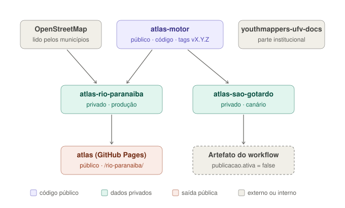

# atlas-motor

Código e estrutura comuns do **Atlas Colaborativo** do Programa Youthmappers UFV: atlas municipais abertos, feitos a partir do OpenStreetMap, com medição de completude em relação às bases oficiais, publicados como site e PDF.

Cada município tem o seu repositório (`atlas-<cidade>`), que guarda **só** configuração, dados e textos, usa este motor numa versão fixada e publica o próprio site no GitHub Pages. O código vive num lugar só: uma correção ou um indicador novo chega a todos os municípios, e nenhum repositório municipal diverge da estrutura.

```
youthmappers-ufv/atlas-motor        público    este repositório: código, catálogo, modelos, workflows
youthmappers-ufv/atlas-<cidade>     público    um por município: atlas.toml, temas.toml, dados/, atlas/;
                                               publica o site no próprio GitHub Pages (só dados públicos)
```



Detalhes e o ciclo mensal de um município em [docs/arquitetura.md](docs/arquitetura.md).

## O que tem aqui

```
VERSAO, CHANGELOG.md    versão atual (vX.Y.Z) e o que mudou em cada uma
catalogo/
  temas.toml            as pranchas (número, título, consulta, base de referência, recorte)
  consultas/            uma consulta Overpass por prancha ({{bbox}} = caixa do município)
  esquemas/             esquemas dos CSV levantados pelas equipes
livro/                  modelo do livro Quarto: método, dados, estilo, _quarto.modelo.yml
modelos/prancha.qmd     modelo de prancha (usado por ativar_tema.py)
modelo-local/           modelo de repositório municipal (usado por novo_local.py)
scripts/
  baixar_osm.py         retrato do OSM do município
  validar.py            integridade do repositório do município (CI em todo PR)
  indicadores.py        completude C_t e Q_t e indicadores internos
  mapas.py              mapas das pranchas (matplotlib)
  construir.py          monta o livro e renderiza site e PDF
  novo_local.py         cria o repositório de um município novo pelo código IBGE
  instalar_ganchos.py   instala no município o gancho de pre-push com o validador
  ativar_tema.py        abre uma prancha num município
  atualizar_motor.py    muda a versão do motor usada por um município
  serie_historica.py    série histórica dos indicadores de um município, a partir do Git
.github/workflows/      reutilizáveis (verificar, atualizar-dados, publicar) e os testes do motor
testes/                 testes, com o município sintético testes/exemplo/
docs/                   arquitetura (com diagramas em figuras/) e configuração do GitHub
CITATION.cff            como citar o software
```

## Município novo

Com o motor clonado numa pasta e os repositórios municipais ao lado dele:

```bash
python atlas-motor/scripts/novo_local.py --nome "São Gotardo" --ibge 3162104 --baixar --git
```

O script busca no OSM o limite (pelo `IBGE:GEOCODIGO`), a caixa envolvente, o Wikidata e a sede; preenche o modelo; baixa o primeiro retrato; e faz o primeiro commit em `../atlas-sao-gotardo`. Depois, siga [docs/configuracao-github.md](docs/configuracao-github.md) para criar o repositório (público), ligar o GitHub Pages, proteger a `main` e dar acesso à equipe e à prefeitura parceira. Município sem parceria: `--privado` (o atlas sai só como artefato).

## Uso num município

```bash
cd atlas-rio-paranaiba
python ../atlas-motor/scripts/instalar_ganchos.py    # uma vez por clone
python ../atlas-motor/scripts/validar.py
python ../atlas-motor/scripts/baixar_osm.py
python ../atlas-motor/scripts/ativar_tema.py saude
python ../atlas-motor/scripts/construir.py --renderizar todos      # site e PDF em _construcao/livro/_site/
python ../atlas-motor/scripts/construir.py --previa                # prévia ao vivo (quarto preview)
```

Requisitos: Python 3.11+ (validação e testes só com a biblioteca padrão), `pip install -r requirements.txt` (matplotlib, para os mapas) e [Quarto](https://quarto.org); para o PDF, TinyTeX (`quarto install tinytex`) ou MiKTeX.

## Versões

O município declara a versão em `atlas.toml` (`[motor] versao = "vX.Y.Z"`) e chama os workflows na mesma versão (`...@vX.Y.Z`); o validador confere que batem. Os workflows baixam o motor na versão declarada pelo município **na versão do município que está sendo publicada**: uma edição antiga é sempre regerada como foi. Localmente, `construir.py`, `validar.py` e `baixar_osm.py` também rodam na versão declarada, extraída da tag do clone ao lado (`--motor-atual` usa o motor da pasta). As tags publicadas são protegidas e nunca mudam. Política de versões e o que mudou: [CHANGELOG.md](CHANGELOG.md). Como mudar o motor: [CONTRIBUTING.md](CONTRIBUTING.md).

## Licença

A definir pelo coordenador do programa (proposta: MIT para o código; CC BY 4.0 para os textos do modelo). Por ser público, o repositório precisa da licença antes do primeiro push.
