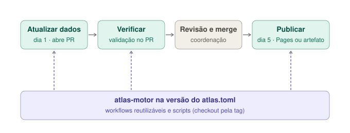

# Arquitetura

O atlas fica em repositórios separados por papel: um **motor** público com o código, um repositório **privado por município** com os dados e os textos, e um repositório **público só de saída** com o site gerado. A parte institucional (proposta, registro no RAEX, relatórios, orientação) fica no repositório de documentos do programa, sem ligação de código.

| Repositório | Visibilidade | Conteúdo |
|---|---|---|
| `atlas-motor` | público | Catálogo de temas e consultas, esquemas, scripts (retrato do OSM, validação, indicadores, mapas, construção), modelo do livro Quarto, modelo de município (`novo_local.py`), workflows reutilizáveis, registro de pesquisa. Versões `vX.Y.Z`. |
| `atlas-<cidade>` | privado | `atlas.toml` (identificação, **versão do motor**, publicação), `temas.toml` (pranchas abertas), retratos do OSM, bases oficiais, levantamentos de campo, textos das pranchas e três workflows que só chamam os do motor. Acesso da equipe e da prefeitura daquele município. |
| `atlas` | público | Site e PDF gerados, uma pasta por município, servidos pelo GitHub Pages. Ninguém edita à mão. |
| `youthmappers-ufv-docs` | privado | Parte institucional do projeto. |

**Por que assim.** No plano gratuito do GitHub, repositório privado não publica Pages (daí o `atlas` só de saída) e só chama workflows de repositório público (daí o motor público). Separar motor e municípios evita forks divergentes: uma correção no motor chega a todos pela atualização de versão. Decisões em `pesquisa/decisoes/` (0001 a 0005).

**Versão fixada.** Cada município declara no `atlas.toml` a versão do motor que usa, e os workflows chamam o motor nessa tag (o validador confere que batem). Uma versão nova do motor não muda nada num município até ele atualizar (`scripts/atualizar_motor.py`), e uma edição antiga refeita hoje usa o mesmo motor de quando foi feita. Isso permite o papel de **canário** (decisão 0005, [`instancias.md`](instancias.md)): um município sem parceria recebe cada versão primeiro e, com `publicacao.ativa = false`, gera o atlas só como artefato do workflow.

## Ciclo mensal de um município

1. **Dia 1 — Atualizar dados:** baixa o retrato do OSM e abre um PR com a diferença.
2. **Verificar:** roda em todo PR (validação de integridade e construção do site).
3. **Revisão e merge:** pela coordenação, só com *Verificar* verde.
4. **Dia 5 — Publicar:** gera site e PDF e envia ao `atlas` (ou guarda como artefato). Tags `v*` no município criam edições numeradas.

Cada workflow faz o checkout do município e do motor (na versão do `atlas.toml`) lado a lado. Hora e minuto dos agendamentos são próprios de cada município, para não coincidirem.

## Na máquina local

As pastas ficam lado a lado (`atlas-motor/`, `atlas-<cidade>/`). De dentro de um município, `python ../atlas-motor/scripts/construir.py --previa` monta o livro em `_construcao/livro/` (fora do Git) e abre a prévia. Localmente vale o motor que está na pasta, qualquer que seja a versão declarada (o script avisa a diferença); a versão fixada vale no GitHub.

## Figuras

Os diagramas estão em `figuras/`. O `.svg` é a fonte; `python docs/figuras/exportar.py` gera o `.pdf` (vetorial, para LaTeX) e o `.png` com o Chrome ou o Edge.
